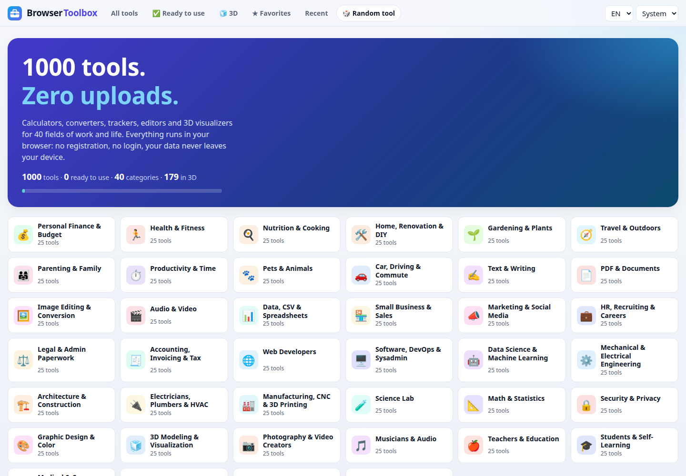

# Browser Toolbox

A free platform of **1000 browser tools** across 40 fields: finance, health, cooking, DIY, travel,
writing, PDF and images, data, business, engineering, science, music, education and more.
Every tool runs entirely in your browser. No registration, no login, no uploads: your data never
leaves your device.

**Try it: https://hermes98761234.github.io/browser-toolbox/**

[](https://github.com/hermes98761234/browser-toolbox/actions/workflows/deploy.yml)



## Features

- **Catalog of 1000 tools** with preview images, 50 per page, search, and filters by category,
  type (calculators, converters, trackers, planners, generators, visualizers, editors…), 2D/3D,
  technology and status.
- **Tools built one by one**: each lives in its own lazily loaded chunk, so the catalog stays fast.
  Tools that are not built yet show their build plan.
- Favorites and recently opened tools, stored locally.
- Tool state is saved in the browser and many tools offer share links, CSV/JSON export and backups.
- English and Ukrainian interface, light/dark theme, works on phones.

## How it works

- `data/tools.md` is the master list. `node scripts/build-catalog.mjs` parses it into
  `src/data/catalog.json`.
- `src/lib/catalog.ts` derives each tool's type and technologies, and implements filters and paging.
- Card thumbnails are drawn procedurally on canvas (`src/previews`) in the category's colours.
- A tool is "ready" when `src/tools/<slug>.tsx` exists (found with `import.meta.glob`).
  See [src/tools/README.md](src/tools/README.md) for the tool contract and the shared kit
  (`src/kit`): inputs, stats, tables, SVG charts and a three.js stage.
- React 19 + Vite + TypeScript, tested with vitest, linted with oxlint, deployed to GitHub Pages by
  GitHub Actions.

## Quick start

```bash
npm install
npm run dev      # http://localhost:5173
npm test
npm run build
```

## License

MIT, see [LICENSE](LICENSE).
